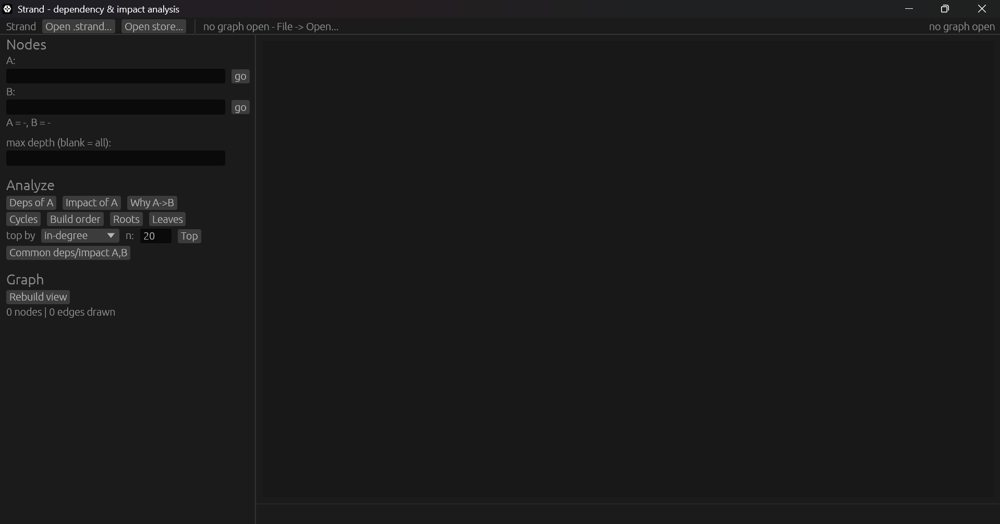

# Strand

[](https://github.com/Biggest-Bee/Strand/actions/workflows/ci.yml)



A Rust **dependency and impact analysis tool** built on a fast,
memory-mapped **CSR (compressed sparse row) graph engine**.

Strand answers the question *"what breaks if I change X?"* in a second or
two, even on graphs with tens of millions of edges, with no server and
no query language:

```console
$ strand build deps.csv -o deps.strand
$ strand impact deps.strand serde_json
impact of [serde_json]: 20 affected (6 direct, 14 transitive)
$ strand why deps.strand my-app serde_json
my-app -> serde -> serde_json
```

## Why Strand

Existing tools are either in-memory libraries (petgraph, igraph, NetworkX)
or server databases (Neo4j). Strand's niche:

1. **Fast-open, zero-copy, single-file graphs.** A `.strand` file is a
   memory-mapped CSR with forward *and* reverse adjacency. Opening is a
   header parse + validation; traversals read straight from the mapping.
2. **Dependency/impact analysis as a first-class feature**: blast radius,
   why-paths, cycle detection, risk ranking, build order — all deterministic
   and scriptable (`--json` everywhere).
3. **Embeddable**: `Graph::open("x.strand")` from Rust, no server.

**`strand-store`** is an embeddable read-write graph store —
"SQLite for graphs" — with transactions, snapshots, a write-ahead log,
crash-safe compaction, and the same analysis algorithms running on the
merged view.

## Repository layout

```
crates/
  strand-core/      file format, mmap reader, builder, algorithms
  strand-import/    importers (cargo metadata JSON, CSV/TSV edge lists)
  strand-cli/       the `strand` binary
  strand-store/     embeddable read-write store (base + WAL delta)
  strand-app/       desktop GUI (eframe/egui) for browsing + analysis
docs/
  FORMAT.md         binary format spec (normative, .strand + .strandb)
testdata/           sample graphs used by tests and docs
```

Tests live in each crate's `tests/` directory (see [Testing](#testing)).

## Quick start

```console
cargo install --path crates/strand-cli   # or: cargo build --release

# From an edge list (src,dst[,weight]; "src depends on dst"):
strand build deps.csv -o deps.strand

# Multiple inputs merge into one graph (names must match across files):
strand build frontend.csv backend.csv meta.json -o all.strand

# From cargo metadata:
cargo metadata --format-version 1 > meta.json
strand build meta.json -o deps.strand

# Scan a project folder and build a source-level dependency graph
# (skips target/, .git/, node_modules/):
strand scan ./my-project -o deps.strand

# Rust (mod/use/#[path]/include!/...crate paths), Python (import/from,
# relative imports), JS/TS (import/export-from/require, index resolution).
# --lang rust|python|js restricts to one language; default scans all.
strand scan ./my-project --lang python -o pydeps.strand

# Analyze:
strand info deps.strand
strand deps deps.strand my-crate --depth 3
strand impact deps.strand serde --by-depth
strand why deps.strand my-app serde_json
strand cycles deps.strand
strand top deps.strand --by impact -n 20
strand order deps.strand --critical-path
strand roots deps.strand
strand leaves deps.strand
strand common deps.strand deps a b
```

Every command accepts `--json` for CI use, e.g. fail a PR when the blast
radius of a changed package exceeds a threshold.

## The store (`strand-store`)

For graphs that change, `strand-store` keeps the immutable `.strand` base
and layers a small write-optimized delta on top:

```rust
use strand_store::Store;

let db = Store::open("graph.strandb")?;

// One writer at a time (enforced by an fd-lock file); readers are unblocked.
{
    let mut tx = db.begin_write()?;
    tx.add_edge("app", "lib")?;
    tx.remove_edge("app", "old-lib")?;
    tx.commit()?;              // WAL append + fsync -> durable
}

// Any number of consistent point-in-time snapshots; compaction never
// invalidates them (they pin their own Arc'd base+delta).
let snap = db.begin_read()?;
let view = snap.view();                  // implements strand_core::view::GraphView
let depths = strand_core::algo::bfs(&view, &[core_id], Dir::In, None);

db.compact()?;   // fold delta into a fresh base-<epoch>.strand, atomic manifest swap
```

- **Durability**: each commit is one WAL record `[len][crc][ops]`, fsynced
  before `commit()` returns. On open, replay stops at the first bad
  checksum — torn tail writes lose at most the uncommitted tail.
- **Reads**: with an empty delta, neighbor iteration *is* the pure CSR fast
  path; with a small delta, untouched nodes still take it (per-node merge
  only where the delta has ops).
- **Compaction**: rebuilds a new immutable base, fsyncs, atomically swaps
  `manifest.json`, reclaims old epoch files lazily. Live snapshots keep
  their pinned `Arc`s, so readers are never blocked.
- **Node removal**: `remove_node` tombstones the id; re-adding the name
  creates a fresh id, so stale incident edges never resurrect.

Store layout and the WAL/op encoding are specified in
[`docs/FORMAT.md`](docs/FORMAT.md#store-directory-format-strandb).

## Desktop app (`strand-app`)

A native window (eframe/egui, no webview) for people who'd rather click
than type:

```console
cargo run -p strand-app        # or: cargo build --release -p strand-app
```

- **Open .strand…** loads an immutable graph; **Open store…** loads a
  `.strandb` directory (read-write if the lock is free, read-only
  otherwise — analyses work identically on the merged view).
- Pick nodes A and B — the boxes autocomplete as you type (up to 8
  case-insensitive substring matches; the index is skipped on graphs over
  200k nodes) — then run **Deps**, **Impact**, **Why A->B**,
  **Cycles**, **Build order**, **Roots**, **Leaves**, **Top** (in-degree /
  impact / pagerank), and **Common deps/impact** — all with an optional
  depth limit.
- Report rows that name a single node are clickable: clicking one selects
  it as node A, so you can walk the graph (e.g. click an impacted
  dependent, then re-run Impact).
- The canvas draws the graph (ring layout by BFS depth after an
  impact/deps run, golden-angle scatter otherwise), highlighting the
  affected set. Capped at 4k nodes / 60k edges for interactive frame rates.

The GUI is read-only; writes go through the `strand-store` API.

## File format

See [`docs/FORMAT.md`](docs/FORMAT.md). Highlights:

- 128-byte header + 10 sections, all 8-byte aligned, little-endian.
- Forward and reverse CSR adjacency, sorted targets, optional f32 weights.
- xxh64 checksum over all post-header bytes; readers validate magic,
  version, layout, monotonic offsets, target bounds, and UTF-8 names before
  trusting any slice. Corrupt/truncated files produce clean errors.
- Node ids are dense `u32`s assigned by lexicographic name order, so builds
  are **byte-for-byte deterministic**.

## Benchmarks

Criterion, synthetic graph (i5-1335U, 12 threads, 8GB RAM, release build):

| Operation | 200k nodes / ~1M edges |
|---|---|
| `strand/open` (mmap + full validation + checksum) | ~21 ms |
| reverse BFS (`impact`) | ~35 ms |
| Tarjan SCC (iterative) | ~94 ms |
| PageRank (100 iters, rayon) | ~151 ms |
| petgraph: build `Graph` + one BFS, same edges | ~123 ms |

Store read path (`strand-store`, 20k nodes / 100k edges, reverse BFS over
the merged view vs the same BFS on the bare `Graph`):

| View | time |
|---|---|
| pure CSR `Graph` | ~7 µs |
| store snapshot, empty delta | ~8–11 µs |
| store snapshot, 200-edge delta | ~9–23 µs |

Timings are microseconds on a small graph and fluctuate run-to-run; the
structural point is that the empty-delta path is within ~10–20% of pure CSR
and the merge cost is proportional to delta-touched nodes, not graph size.
Reproduce: `cargo bench -p strand-store`.

Notes:

- `open` validates *everything* (layout, monotonic offsets, target bounds,
  UTF-8 names, xxh64 checksum over the whole file), so its cost scales with
  file size. Measured on a 790MB / 50M-edge file (below): ~0.5s warm,
  ~1.8s cold.
  The mapping itself is zero-copy — traversals touch only the pages they
  need.
- petgraph has no on-disk CSR format; the comparison above is in-memory
  construction + BFS, not open+query. Strand's advantage is that the "open"
  cost is paid once and queries then run directly on the mapped file with
  no per-query deserialization.
- `impact_sizes` (used by `top --by impact`) is the naive per-node reverse
  BFS, parallelized with rayon — O(V·(V+E)). Fine for small/medium graphs;
  a condensation-DAG algorithm is planned for very large ones.

Reproduce: `cargo bench` (env `STRAND_BENCH_NODES`, `STRAND_BENCH_EDGES`).

### Large graph (10M nodes / 50M edges)

`cargo run --release -p strand-core --example bigbench` streams a
10,000,000-node / 50,000,000-edge graph (790MB `.strand` file) directly in
the file format, then times the real open + analyses. Measured on an
i5-1335U (12 threads, 8GB RAM); page cache warm unless noted:

| Operation | time |
|---|---|
| file generation (streaming writer) | ~3.7 s |
| `Graph::open` (mmap + validation + xxh64 over 790MB) | ~0.5 s warm / ~1.8 s cold |
| forward BFS visiting all 10M nodes / 50M edges | ~1.3 s |
| Tarjan SCC (iterative) | ~9 s |
| PageRank (~0.12 s/iter, rayon) | ~0.25 s — converged in ~2 iters |

Caveat: the synthetic graph is near-regular (every node has exactly 5
out-edges), so PageRank converges unusually fast. Real dependency graphs
are skewed with a few hub nodes; expect more iterations there. BFS and SCC
times are edge-count bound and should transfer to skewed graphs.

## Testing

- Unit tests per algorithm on hand-checked graphs.
- `proptest`: random graphs built, re-opened, and compared against an
  independent in-memory reference (adjacency, reachability, path validity).
- Corruption tests: truncations and byte flips must produce clean errors.
- Determinism test: same graph from different input order → identical bytes.
- CLI end-to-end tests via `CARGO_BIN_EXE_strand`.
- Store: model-based randomized op test vs an in-memory graph; WAL torn-tail
  and bit-flip recovery; snapshot isolation across commits and compaction;
  read-only fallback when another writer holds the lock; a crash-consistency
  harness that corrupts the WAL at random points and verifies the store
  always equals exactly some prefix of committed transactions (500 cases in
  CI, 10,000 available via `cargo test -p strand-store -- --ignored`).

Tests live next to the code: `crates/strand-core/tests/` (algorithms,
proptest, roundtrip/corruption/determinism), `crates/strand-cli/tests/cli.rs`
(end-to-end CLI incl. impact-count consistency, multi-input build, and a
`scan` fixture project), `crates/strand-import/tests/scan.rs` (scanner
resolution rules), and
`crates/strand-store/tests/store.rs` (model-based ops, WAL recovery,
snapshots, compaction, crash harness).

```console
cargo test
```

## Limitations (honest list)

- No query language — Rust API + CLI + desktop GUI.
- The GUI (`strand-app`) is read-only and caps its canvas at 4k nodes /
  60k edges; huge graphs are better served by the CLI.
- `top --by impact` uses SCC condensation + bitset ancestor sets
  (`O(E·C/64)`); graphs with more than ~32k components fall back to the
  naive per-node BFS.
- `why --all-paths` enumerates *shortest* chains only, with a step budget.
- Weighted edges: `why --weighted` runs Dijkstra over edge weights
  (unweighted graphs count every edge as 1.0). The store preserves
  weights through compaction.
- The store is single-writer per directory (one process holds the write
  lock); scale-out means one store per shard.
- Store delta is in-memory: a very large un-compacted delta costs RAM, and
  readers pin their snapshot's delta — compact periodically.
- Crash safety covers WAL commits and manifest swaps; a crash *during*
  base-file writing leaves an orphan `base-*.strand.tmp`-style file that is
  simply never referenced (the builder writes-then-renames).
- mmap assumes files aren't truncated while open (inherent SIGBUS risk);
  the write path always writes-then-renames.
- `strand scan` is a pattern-matching scanner, not a real parser: it
  handles `mod`/`use`/`#[path]`/`include!` (Rust), `import`/`from`
  incl. relative imports (Python), and `import`/`export-from`/`require`
  (JS/TS). It misses macro-generated modules, `include_str!` payloads,
  tsconfig path aliases, and dynamic language tricks. Nodes are file
  paths, so it answers "what breaks if I change `src/foo.rs`?" —
  package-level questions still want `cargo metadata` input.

## License

[Apache-2.0](LICENSE) — permissive, patent-granting, and it explicitly
allows creating content about the software (reviews, videos, tutorials)
without permission.
